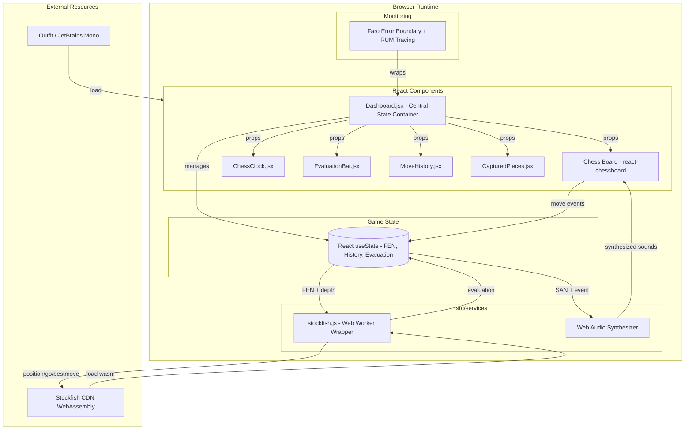

# Architecture

## Project Structure

<Tree>
  <Tree.Folder name="docs" defaultOpen>
    <Tree.File name="docs.json" highlight />
    <Tree.File name="custom.css" />
    <Tree.File name="architecture.mdx" />
    <Tree.File name="components.mdx" />
    <Tree.File name="configuration.mdx" />
    <Tree.File name="deployment.mdx" />
    <Tree.File name="features.mdx" />
    <Tree.File name="index.mdx" />
    <Tree.File name="installation.mdx" />
    <Tree.File name="license.mdx" />
    <Tree.File name="services.mdx" />
  </Tree.Folder>
  <Tree.Folder name="public">
    <Tree.File name="favicon.ico" />
  </Tree.Folder>
  <Tree.Folder name="src" defaultOpen>
    <Tree.Folder name="assets">
      <Tree.File name="hero.png" />
      <Tree.File name="react.svg" />
      <Tree.File name="vite.svg" />
    </Tree.Folder>
    <Tree.Folder name="components" defaultOpen>
      <Tree.File name="AboutModal.jsx" />
      <Tree.File name="CapturedPieces.jsx" />
      <Tree.File name="ChessClock.jsx" />
      <Tree.File name="Dashboard.jsx" highlight />
      <Tree.File name="EvaluationBar.jsx" />
      <Tree.File name="GameAnalysisModal.jsx" />
      <Tree.File name="MoveHistory.jsx" />
    </Tree.Folder>
    <Tree.Folder name="services" defaultOpen>
      <Tree.File name="audio.js" />
      <Tree.File name="stockfish.js" highlight />
    </Tree.Folder>
    <Tree.File name="App.css" />
    <Tree.File name="App.jsx" highlight />
    <Tree.File name="index.css" />
    <Tree.File name="main.jsx" highlight />
  </Tree.Folder>
  <Tree.File name=".gitignore" />
  <Tree.File name=".oxlintrc.json" />
  <Tree.File name="index.html" />
  <Tree.File name="LICENSE" />
  <Tree.File name="package.json" />
  <Tree.File name="vite.config.js" />
</Tree>

## Entry Points

### `index.html`

Minimal HTML shell containing a `#root` div and the module script import.

### `src/main.jsx`

Application entry point that:

1. **Initializes Grafana Faro** for Real User Monitoring, HTTP tracing, and error tracking
2. Registers the React integration for component stack traces
3. Creates the React root and renders `<App />`

### `src/App.jsx`

Root component that wraps `<Dashboard />` inside a `<FaroErrorBoundary>`, providing graceful crash recovery with a custom dark-themed fallback UI and reload button.

## Key Patterns

### Immutable Game Updates

Always create a **new `Chess()` instance** from the current FEN rather than mutating the existing instance. This ensures React state updates are predictable and enables reliable position navigation.

```javascript
const newGame = new Chess(currentFen);
const move = newGame.move({ from, to, promotion: 'q' });
```

### Stockfish Turn Handling

Stockfish evaluations are relative to the **active side** in the FEN position. The service converts to absolute scores (positive = White advantage):

```javascript
if (this.currentTurn === 'b') {
  value = -value; // Flip for Black's perspective
}
```

### Review Mode Blocking

Drag-and-drop moves are disabled when the user is viewing a past position (`activeMoveIndex !== historyFens.length - 1`). This prevents accidental moves while browsing history.

### CORS Workaround for Stockfish

The Stockfish WebAssembly engine is loaded from a CDN using a **Blob URL + `importScripts()`** pattern. This circumvents CORS restrictions that would otherwise prevent loading external worker scripts.

### State Management

The application uses React `useState` hooks for all state. The Dashboard component serves as the central state container, passing props down to child components. Key state includes:

| State Variable | Type | Purpose |
|---------------|------|---------|
| `game` | Chess instance | Current position and rules |
| `fen` | string | Current board FEN |
| `history` | array | SAN move history |
| `historyFens` | string[] | FEN after each move (for navigation) |
| `activeMoveIndex` | number | Currently viewed position |
| `evaluation` | object | Current engine evaluation |
| `isFlipped` | boolean | Board orientation |
| `isPaused` | boolean | Game paused state |
| `isGameOver` | boolean | Game ended flag |

## Styling Architecture

### Design Tokens

CSS custom properties defined in `:root` (dark mode) and `[data-theme='light']` (light mode):

- **Colors**: `--color-primary` (indigo), `--color-secondary` (cyan), semantic colors
- **Backgrounds**: `--bg-dark-base`, `--bg-card`, `--bg-widget` with glassmorphism (rgba + backdrop-filter)
- **Typography**: `--font-sans` (Outfit), `--font-mono` (JetBrains Mono)
- **Borders**: `--border-color` with subtle glow variants
- **Transitions**: Smooth and fast cubic-bezier curves

### Layout

The dashboard uses a responsive CSS Grid layout (`dashboard-grid`):

```text
+---------------------------------------------+
|                   Header                    |
+----------+------------------+---------------+
|  Clocks  |    Board         |   Eval Bar    |
|  (top)   |    (center)      |   (right)     |
+----------+                  +---------------+
|  Clocks  |                  |  Move History |
|  (bottom)|                  |  + Captured   |
+----------+------------------+---------------+
|              Action Buttons                 |
+---------------------------------------------+
```

## Game State Flow

### 1. Setup Screen (`gameStarted = false`)

The user configures:

- **Game mode**: PvP or AI
- **Color**: White, Black, or Random (AI mode only)
- **Difficulty**: Stockfish search depth (AI mode only)
- **Time control**: Clock preset (1+0, 3+2, 5+0, 10+0, 30+0)
- **Board theme**: Visual color scheme

### 2. Active Game (`gameStarted = true`)

Once started, the game enters active mode:

- A `Chess` instance (from `chess.js`) holds the current position
- `historyFens[]` stores the FEN string after every move
- `activeMoveIndex` tracks which position the user is currently viewing
- The Stockfish engine evaluates positions after each move

### 3. Move Execution

```
User drops piece → onPieceDrop callback
  → Validates: correct turn, not in review mode, game not over/paused
  → Creates new Chess() instance from current FEN
  → Attempts move via chess.js
  → On success:
    → Plays appropriate sound (move/capture/check/game-over)
    → Updates game state, FEN, history array
    → Appends new FEN to historyFens
    → Triggers Stockfish evaluation
    → AI mode: triggers Stockfish best move calculation
```

### 4. AI Move (Stockfish)

```
Stockfish.calculateBestMove(fen, depth)
  → Sends "position fen ..." to worker
  → Sends "go depth N" to worker
  → Worker responds with "bestmove e2e4"
  → makeAIMove() parses UCI notation
  → Calls executeMove() with parsed from/to/san
```

## Architecture Diagram


