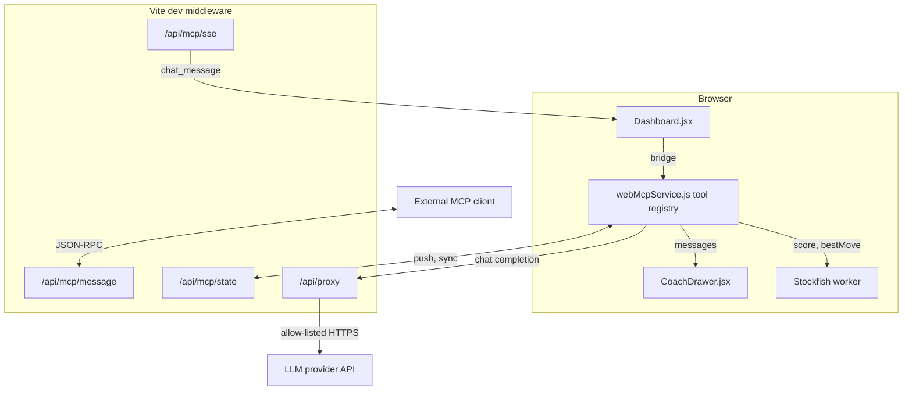

# WebMCP Integration

Satranj exposes its live game through **WebMCP** — a browser-side Model Context Protocol registry — so that the in-app coach *and* external LLM agents can inspect the position, evaluate with Stockfish, and post advice onto the board. The registry, the dev transport bridge, and the proxy are three separate pieces.



## Tool registry

`src/services/webMcpService.js` registers the tools on `window.modelContext`, `document.modelContext`, and `navigator.modelContext`. Visiting agents can enumerate them with `window.modelContext.listTools()` and invoke them with `tool.execute(params)`.

Five tools are registered:

| Tool | Read-only | Parameters | Effect |
|------|-----------|------------|--------|
| `post_chat_message` | No | `message` (required), `sender`, `suggestedMoves`, `highlightSquares`, `arrows`, `clearPrevious` | Posts a message into the Coach Drawer, optionally tinting squares and drawing arrows |
| `get_game_state` | Yes | — | Returns FEN, turn, move history, clocks, and match settings |
| `get_legal_moves` | Yes | `square` (optional filter) | Returns legal moves with capture/check/castling flags |
| `get_position_analysis` | Yes | `depth` (2–15, default 8) | Runs Stockfish and returns formatted score, best move, and PV |
| `highlight_board` | No | `highlightSquares`, `arrows`, `clearPrevious` | Paints or clears board cues without a chat message |

## The game bridge

The React dashboard registers a bridge with `setActiveGameBridge(bridge)`. The tools delegate to it:

| Bridge method | Backed by |
|---------------|-----------|
| `getGameState()` | Current `Chess` instance + settings |
| `getLegalMoves(square)` | `chess.js` `moves({ verbose: true })` |
| `getPositionAnalysis(depth)` | `StockfishService.evaluatePositionPromise` |
| `postChatMessage(payload)` | Enqueues a drawer message + applies highlights |
| `highlightBoard(payload)` | Updates square styles and arrows |

## In-page message delivery

Messages posted by tools flow through an in-memory inbox so they are not lost while the drawer is closed:

- `enqueueChatMessage(msg)` — append (capped at the last 50 messages).
- `subscribeChatMessages(cb)` — live subscription; returns an unsubscribe function.
- `drainChatMessages()` — snapshot for replay on drawer mount.

## Dev MCP transport (Vite plugin)

`vite.config.js` ships a `vite-webmcp-plugin` that mounts four middleware routes. These run **only in dev** (`import.meta.env.DEV`).

| Endpoint | Method | Purpose |
|----------|--------|---------|
| `/api/mcp/sse` | GET | Server-Sent Events stream that pushes `chat_message` and `highlight_board` events to the browser |
| `/api/mcp/message` | POST | JSON-RPC 2.0 dispatcher for external MCP clients |
| `/api/mcp/state` | GET / POST | Browser pushes game state up; external tools read it back |
| `/api/proxy` | POST | Same-origin proxy for allow-listed AI provider hosts |

Supported JSON-RPC methods: `initialize`, `ping`, `tools/list`, and `tools/call`. Example:

```json
{ "jsonrpc": "2.0", "id": 1, "method": "tools/list" }
```

```json
{ "jsonrpc": "2.0", "id": 2, "method": "tools/call",
  "params": { "name": "post_chat_message",
              "arguments": { "message": "Watch for Nxe5!", "suggestedMoves": ["Nf3"] } } }
```

## Provider proxy

Both the dev middleware and the production Cloudflare Pages Function (`functions/api/proxy.js`) forward provider requests so the browser never needs CORS access to the vendor. Both enforce the same **host allow-list**:

```text
generativelanguage.googleapis.com · api.openai.com · openai.com
ollama.com · api.mistral.ai · router.requesty.ai
api.tokenfactory.nebius.com · openrouter.ai
```

Requests to any other host are rejected with `403`. Local `localhost` / `127.0.0.1` targets are additionally permitted by the dev proxy for Ollama. The Cloudflare function requires `https:`; the dev proxy also accepts `http:` for local hosts. Headers `HTTP-Referer` and `X-Title` are forwarded for OpenRouter attribution.

Board arrows provided to `post_chat_message` or `highlight_board` can be formatted as tuples (`[from, to, color]`) or objects (`{ startSquare, endSquare, color }`). They are normalized transparently before rendering on the chessboard to prevent arrow coordinate syntax errors.

See [Configuration](/configuration) for the Vite plugin surface and [Deployment](/deployment) for the Pages Function.
